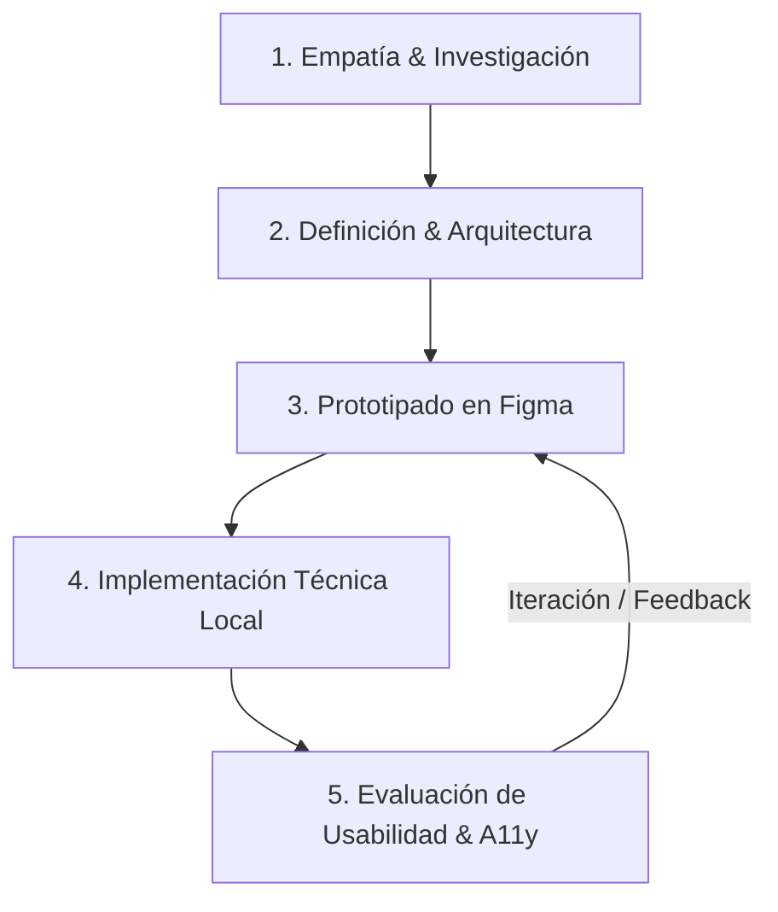

# Flujo de Trabajo Adaptativo, Ciclo DCU y Checklist E.F.I. - Callejeros Río IV

Este documento establece la metodología de trabajo para el equipo de 4 desarrolladores, integrando el **Ciclo de Diseño Centrado en el Usuario (DCU)** con desarrollo local y el **Checklist de Listo (Definition of Done - DoD)** exigido para la **Entrega Final Integradora (E.F.I.)**.

---

## 1. Ciclo DCU (Diseño Centrado en el Usuario) Adaptado al Equipo

El proyecto adopta un enfoque iterativo de DCU ajustado a la dinámica de 4 integrantes trabajando en entornos locales y colaborando vía GitHub:



1. **Fase 1: Empatía & Investigación**:
   - Comprensión de los 3 arquetipos clave en Río Cuarto (Rescatista ocasional, Adoptante, Padrino/Colaborador).
   - Identificación de los puntos de fricción reales: conectividad deficiente en la calle, desactualización de refugios y desconfianza en donaciones.
2. **Fase 2: Definición & Arquitectura de Información**:
   - Priorización de flujos críticos: *Reportar Mascota* y *Ver Adopciones* como CTAs directos desde la portada.
   - Creación del sistema de rotulado accesible en `glosario.md` eliminando jerga técnica.
3. **Fase 3: Prototipado en Figma**:
   - Diseño de los 7 frames principales respetando la escala modular (Poppins/Inter) y contraste semántico WCAG AA.
   - Definición visual de la tarjeta de mascota (`PetCard`) con proporción cuadrada 1:1 y badge de estado.
4. **Fase 4: Implementación Técnica Local (Next.js + Tailwind + Prisma)**:
   - Construcción modular por componentes siguiendo el estándar *mobile-first*.
   - Persistencia local en SQLite sin dependencias de servicios externos en la nube.
5. **Fase 5: Evaluación de Usabilidad & A11y**:
   - Pruebas de navegación táctil (tap targets de 48px) y pruebas de navegación por teclado (`Tab`, `focus-visible`).
   - Verificación de contraste cromático con herramientas automatizadas y manuales.

---

## 2. Flujo de Trabajo Git & Colaboración para 4 Integrantes

- **Ramas de Trabajo**:
  - `main`: Código estable y validado con el Checklist de DoD.
  - Ramas temáticas atómicas: `feature/<nombre-funcionalidad>` o `fix/<nombre-correccion>`.
- **Regla Estricta para SQLite**:
  - Prohibido commitear archivos `dev.db`, `dev.db-journal`, `*.sqlite`.
  - La sincronización de la base de datos entre los 4 compañeros se realiza exclusivamente ejecutando:
    ```bash
    npx prisma migrate dev
    npx prisma db seed
    ```
- **Commits Atómicos y Semánticos**:
  - `feat(ui): implementar PetCard con badge flotante y ratio 1:1`
  - `fix(a11y): añadir atributos alt descriptivos en imágenes de adopción`
  - `docs(contexto): actualizar glosario con nuevos términos de padrinazgo`

---

## 3. Checklist de Listo (Definition of Done - DoD) para la E.F.I.

Para considerar el proyecto completado y listo para la **Entrega Final Integradora (E.F.I.)**, se deben verificar sin excepción los siguientes 10 puntos de control:

- [ ] **1. Shell y Navegación Base (`layout.tsx`)**:
  - Barra superior fija (`Navbar`) con logo, enlaces de navegación y botón de login/registro funcionales.
  - Menú hamburguesa accesible y operativo en pantallas móviles.
  - Pie de página (`Footer`) con enlaces a FAQs, contacto y redes.
- [ ] **2. Portada (Hero Section) Impactante**:
  - Mensaje claro y empático enfocado en la problemática de Río Cuarto.
  - Dos CTAs primarios visibles y operativos: *"Reportar Mascota"* y *"Ver Adopciones"*.
- [ ] **3. Modelo y Migraciones Prisma SQLite**:
  - Esquema `schema.prisma` con modelos `Pet` y `Report` sincronizado en SQLite local.
  - Fixtures de datos de muestra ejecutados (*Manchita*, *Rocky*, *Luna*).
- [ ] **4. Componente `PetCard` Modular**:
  - Fotografía con aspect ratio cuadrado 1:1 (`Next/Image`).
  - Badge de estado dinámico y semántico (*"En Adopción"*, *"Urgente"*, *"Perdido"*).
  - Datos rápidos claros (edad, tamaño, barrio).
  - Botón primario de mínimo 48px: *"Conocer a [Nombre]"*.
- [ ] **5. Formulario Interactivo y Feedback en Vivo**:
  - Formulario de reporte de extravío con campos esenciales y carga de imagen.
  - Procesamiento asíncrono en cliente sin recarga de página.
  - Retroalimentación mediante Modal o Toast verde esmeralda: *"Reporte publicado con éxito. ¡Gracias por ayudar!"*.
- [ ] **6. Diseño Mobile-First & Cero Desborde**:
  - Vista móvil impecable en resoluciones de 320px, 375px y 414px.
  - Cero desplazamiento horizontal no deseado (`overflow-x`).
  - Grilla adaptativa: 1 columna en móvil, 2 en tablet y 3-4 en desktop.
- [ ] **7. Cumplimiento de Accesibilidad WCAG AA**:
  - Ratio de contraste mínimo de **4.5:1** en todo el texto (Light y Dark Mode).
  - Atributos `alt` descriptivos obligatorios en todas las imágenes.
- [ ] **8. Navegabilidad 100% Asistida por Teclado**:
  - Toda acción ejecutable con la tecla `Tab` y activación con `Enter`/`Espacio`.
  - Anillos de foco visibles de alto contraste (`focus-visible:ring-4`).
- [ ] **9. Los 5 Estados de Interacción en Componentes**:
  - Estados *Default*, *Hover*, *Active*, *Focus* y *Disabled* implementados en botones y controles.
- [ ] **10. Calidad de Código y Repositorio Limpio**:
  - Archivos SQLite binarios ignorados en `.gitignore`.
  - Cero advertencias de TypeScript (`strict: true`).
  - Cero código muerto, comentarios innecesarios o `console.log` de depuración.
